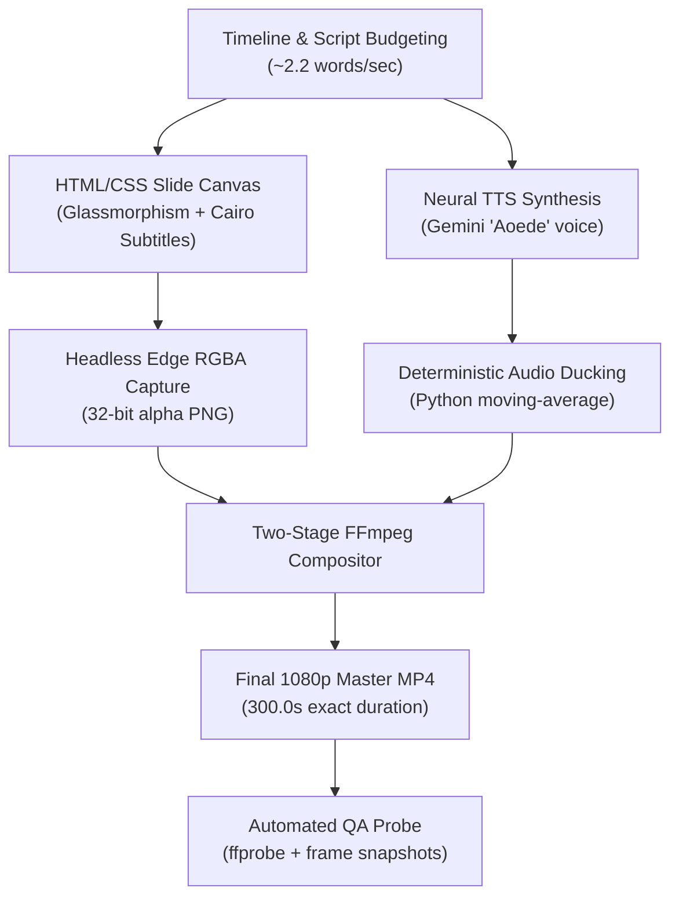

# Competition Pitch Video Production Pipeline

This skill provides an automated, deterministic pipeline to create presentation videos for pitch competitions (e.g., HP IDEA, hackathons, investor demos). It pairs dynamic background video footage with transparent UI cards, synchronized neural voiceovers, burned-in subtitles, and ducked background music.

## Architecture & Workflow Overview



---

## 1. Narration Script & Word Budgeting

Target pacing is **2.0 to 2.2 words per second** (120–135 words per minute) to ensure natural delivery with pauses:
$$\text{Max Words} = \text{Slide Duration (seconds)} \times 2.15$$

* Leave **0.5s silence** at the start of each slide and **1.0s silence** before transitioning.
* Keep sentences concise, punchy, and synchronized with on-screen visual bullets.

---

## 2. Gemini Neural Voiceover Synthesis

Run the synthesis helper [scripts/tts_synthesizer.py](./scripts/tts_synthesizer.py) or invoke Gemini REST API:

```python
# CRITICAL: Send ONLY the raw spoken words in text.
# Do NOT prefix instructions or persona in contents!
payload = {
    "contents": [{"parts": [{"text": clean_spoken_script}]}],
    "generationConfig": {
        "responseModalities": ["AUDIO"],
        "speechConfig": {
            "voiceConfig": {
                "prebuiltVoiceConfig": {"voiceName": "Aoede"}  # Warm, professional female
            }
        }
    }
}
```

* **Model Preference**:
  1. `gemini-3.8-flash-lite-tts` (generous limits, instant generation)
  2. `gemini-3.1-flash-tts-preview`
* **Network safety**: Set `verify=False` in `httpx.Client()` on Windows to avoid local root cert store issues.

---

## 3. Visual Layout & Subtitle Typography

* **1920x1080 HTML/CSS Template**:
  - Container dimensions: `width: 1920px; height: 1080px; overflow: hidden; background: transparent;`.
  - Content Cards: Glassmorphism (`background: rgba(15, 23, 42, 0.75); backdrop-filter: blur(16px); border: 1px solid rgba(255,255,255,0.1);`).
  - **Arabic Subtitles**: Render directly in the HTML DOM at the bottom using font `'Cairo'`, `direction: rtl`, `font-size: 24px`. **Do not use FFmpeg `.srt`/`.ass` filters on Windows**, which corrupt Arabic cursive glyphs and ligatures.

---

## 4. Headless Edge RGBA Screenshot Export

Rasterize the transparent slides using Chromium / Microsoft Edge:

```powershell
& "C:\Program Files (x86)\Microsoft\Edge\Application\msedge.exe" `
  --headless=new `
  --screenshot="slide_01.png" `
  --window-size=1920,1080 `
  --default-background-color=00000000 `
  "file:///C:/path/to/slide_01.html"
```
*(Reference: [references/edge_render_guide.md](./references/edge_render_guide.md))*

---

## 5. Audio Normalization & Music Ducking

Execute [scripts/audio_ducker.py](./scripts/audio_ducker.py) to composite narration over background music:
1. Decode voiceover WAV files and calculate exact segment durations.
2. If voice duration > target duration, apply `atempo` time-compression (capped at `1.08x`).
3. Compute moving-average RMS volume profile of speech.
4. Duck background music by `-16 dB` to `-20 dB` whenever speech is active, with smooth 300ms linear ramps.
5. Apply a 3-second gentle fade-out at the video tail.

---

## 6. Two-Stage FFmpeg Video Compositing

Applying spatial blur filters over 1080p video during real-time overlay drops encoding speeds to `0.015x`. Always use the **Two-Stage Method**:

### Stage 1: Fast Background Bokeh Pre-Processing (~30 sec)
```bash
ffmpeg -y -stream_loop 30 -i bg_raw.mp4 -t 300 -vf "scale=384:216,scale=1920:1080:flags=bilinear,colorchannelmixer=aa=0.45" -c:v libx264 -preset veryfast -crf 22 bg_bokeh_300s.mp4
```

### Stage 2: Concat Demuxer & Overlay Assembly (< 2 min)
Write a timeline concat file `concat_slides.txt`:
```
file 'slide_01.png'
duration 20.0
file 'slide_02.png'
duration 20.0
...
file 'slide_14.png'
```
Assemble with master audio:
```bash
ffmpeg -y -i bg_bokeh_300s.mp4 -f concat -safe 0 -i concat_slides.txt -i master_ducked_audio.wav \
  -filter_complex "[0:v][1:v]overlay=0:0:shortest=1[outv]" \
  -map "[outv]" -map 2:a \
  -c:v libx264 -preset veryfast -crf 20 -pix_fmt yuv420p \
  -c:a aac -b:a 320k \
  -t 300.0 output_master_1080p.mp4
```
*(Reference: [references/ffmpeg_recipes.md](./references/ffmpeg_recipes.md))*

---

## 7. Quality Verification Runbook

Validate the final output before publishing:
1. **Duration Precision**:
   ```powershell
   ffprobe -v error -show_entries format=duration -of default=noprint_wrappers=1:nokey=1 output_master_1080p.mp4
   # Must match target duration exactly (e.g. 300.000000)
   ```
2. **Visual Snapshots**:
   ```powershell
   ffmpeg -ss 00:00:15 -i output_master_1080p.mp4 -vframes 1 verify_01.jpg
   ffmpeg -ss 00:02:30 -i output_master_1080p.mp4 -vframes 1 verify_02.jpg
   ```
