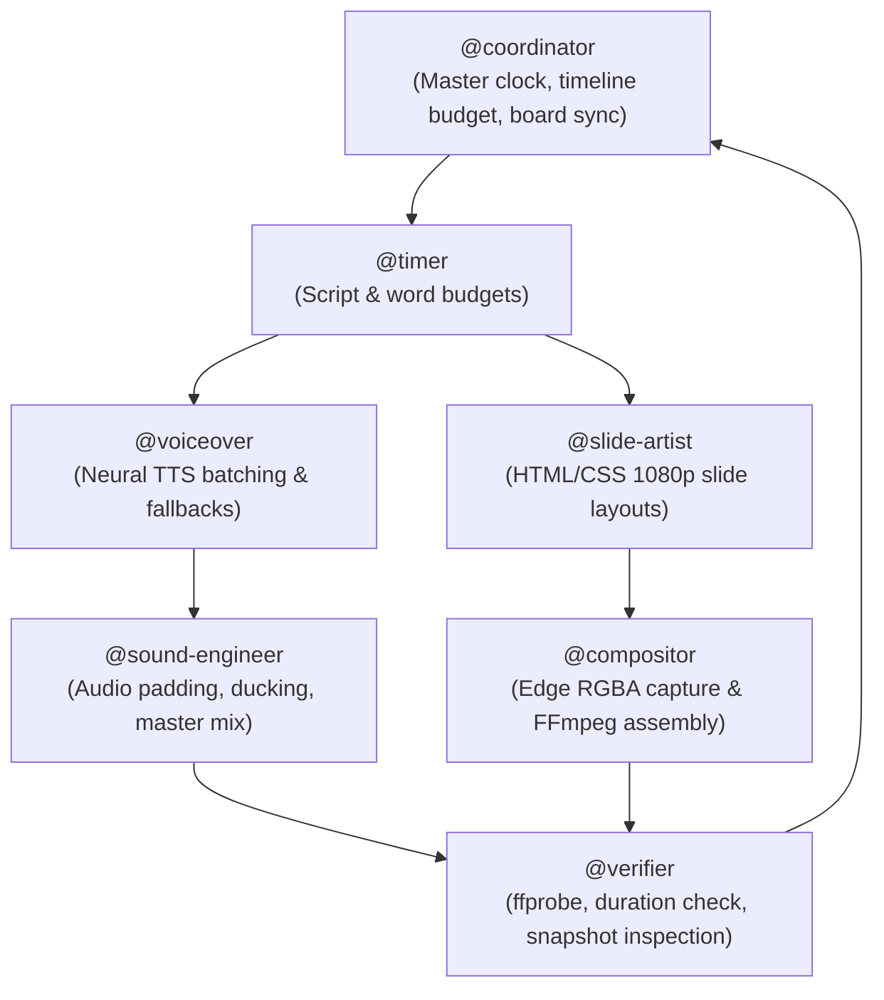

# Swarm Multimedia Pipeline Playbook

This skill defines the multi-agent swarm architecture for high-throughput multimedia generation. It splits video production into decoupled, parallelizable worker streams, completely eliminating worker collisions on shared files.

## Swarm Topology & Role Matrix



---

## 1. Sizing and Partitioning the Swarm

Video production creates bottlenecks if attempted by a single sequential process. Split the workload cleanly:

| Worker Name | Exclusive Scope | Input Artifact | Output Artifact |
|---|---|---|---|
| `@timer` | Word count calculation & slide timestamp allocations | Presentation outline / pitch bullet points | `timeline.json` |
| `@voiceover` | Clean Gemini Neural TTS generation & quota fallback | `timeline.json` | Raw voice WAVs (`slide_*.wav`) |
| `@slide-artist`| Responsive 1080p HTML/CSS slide design & typography | `timeline.json` + slide content text | `slide_*.html` templates |
| `@sound-engineer` | Audio padding, `atempo` correction & BGM ducking | Raw voice WAVs + background music | `master_ducked_audio.wav` |
| `@compositor` | Edge headless rasterization & two-stage FFmpeg assembly | `slide_*.html` + `master_ducked_audio.wav` | `master_output_1080p.mp4` |
| `@verifier` | Duration validation, audio sync & frame snapshots | `master_output_1080p.mp4` | QA validation report + JPEG frames |

---

## 2. Coordinator Initiation Sequence

When launching a media production swarm, run this sequence:

1. **Title the Swarm**:
   ```
   swarm{action:"title", title:"Pitch Video Production Pipeline"}
   ```
2. **Add Workers with Precise Briefs**:
   - Always state who owns what and what "done" looks like.
   - Use the pre-baked brief templates in [references/swarm_brief_templates.md](./references/swarm_brief_templates.md).
3. **Monitor via Handoff Tokens**:
   - Workers post `[ready: <artifact_name>]` when their deliverable is written.
   - Downstream workers react only to the corresponding token.

---

## 3. Communication & Handoff Invariants

1. **Zero Collision on File Writes**:
   - `@slide-artist` only writes into `slides_html/`.
   - `@voiceover` only writes into `audio_raw/`.
   - `@sound-engineer` only writes into `audio_master/`.
   - `@compositor` only writes into `video_staging/`.
2. **Deterministic Durations**:
   - The master timeline duration (e.g. 300.0s) is declared immutable by `@timer`.
   - All subsequent audio clips and slide displays are constrained to match these bounds.
3. **Automated Verification Gate**:
   - No project is marked complete until `@verifier` extracts snapshot frames at the 10%, 50%, and 90% marks and confirms duration down to microsecond accuracy with `ffprobe`.
